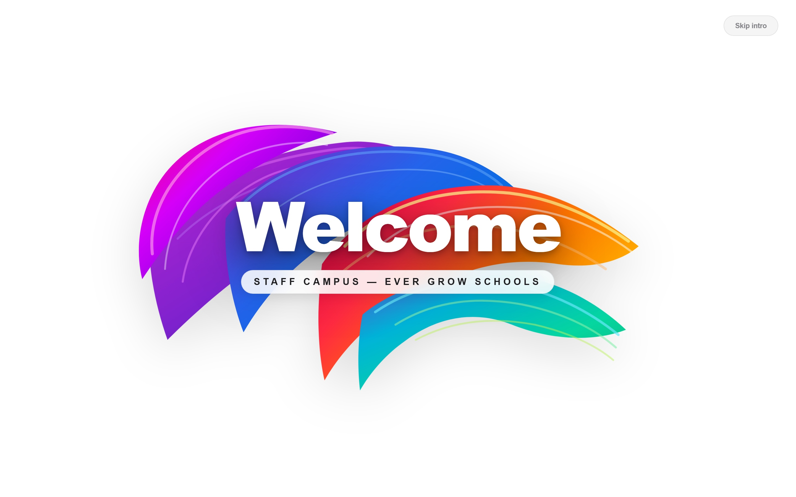
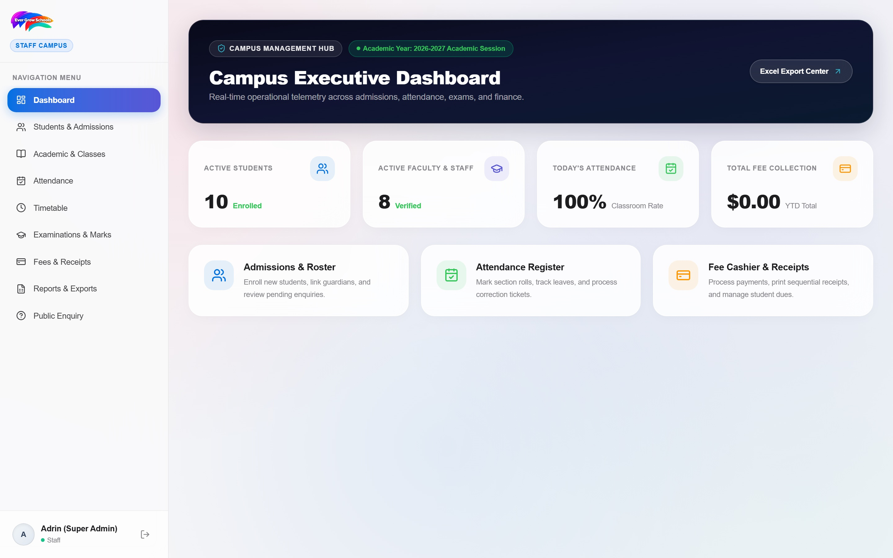
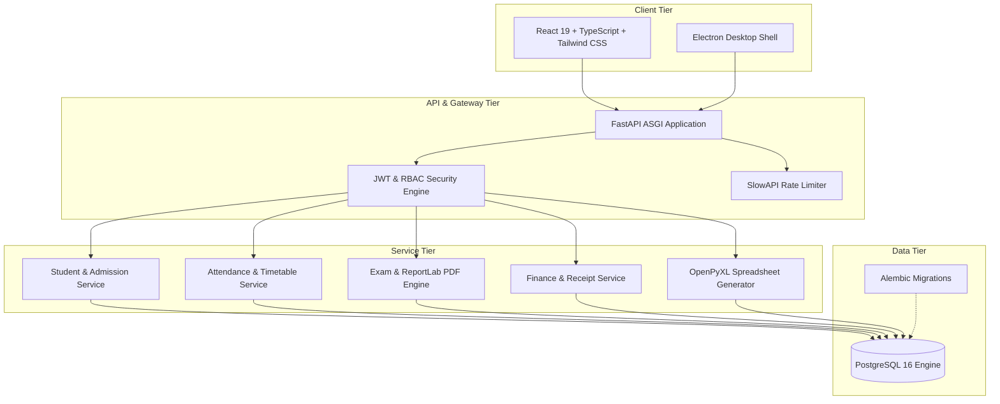

# Product Requirements Document (PRD)
## Centralized School ERP Management System

**Document Version:** 1.0.0  
**Target Release:** Production v1.0  
**Scope:** Campus Operations (1,000 – 3,000 Students)  
**Status:** Approved & Implemented  

---

## 1. Executive Summary & Vision

The **School ERP Management System** is a centralized, role-based enterprise resource planning platform engineered to automate and unify administrative, academic, financial, and communication workflows for a single campus serving 1,000–3,000 students. 

### 1.1 Core Problems Solved
- **Data Fragmentation:** Eliminates disconnected spreadsheets and isolated records by consolidating admissions, attendance, exams, and finances into a unified PostgreSQL schema.
- **Financial Compliance & Leakage:** Prevents revenue leakage through strictly sequenced, immutable receipts (`RCP-YYYY-XXXXX`), concession rules, and automated invoice balance calculations.
- **Academic Operational Bottlenecks:** Replaces manual report card preparation with an automated ReportLab PDF engine and eliminates scheduling conflicts with teacher/room clash validation.
- **Parent-School Transparency:** Provides dedicated, role-guarded portals for parents and students with zero cross-tenant leakage.

---

## 2. User Personas & Role-Based Access Control (RBAC)

The system enforces strict multi-role separation across both the FastAPI backend and React frontend:

| Role | Access Level | Primary Objectives | Key System Modules |
|---|---|---|---|
| **Super Admin / IT Admin** | System-Wide | System configuration, user provisioning, global auditing, database migrations | All modules, Security, Backups |
| **Principal / Vice Principal** | Executive Oversight | Institution-level performance, exam approvals, attendance trends, staff directory | Executive Dashboard, Academic Approvals, Reports |
| **Teacher / Class Mentor** | Classroom & Subject | Daily roll-call attendance, exam mark submission, class timetable view | Attendance Register, Gradebook, Timetable |
| **Cashier / Accountant** | Financial Operations | Fee collection, concession verification, receipt generation, daily reconciliation | Fee Structure, Cashier Desk, Excel Exports |
| **Parent / Guardian** | Linked Student View | Real-time attendance tracking, downloadable exam report cards, fee invoice payments | Parent Portal (`/api/v1/portal/*`) |
| **Student** | Personal Record | Class schedule, homework announcements, published grades | Student Portal |

---

## 3. Core Functional Modules & UI Specifications

---

### Module 0: Web Application Architecture & Unified Portal Login

The web interface is engineered around an Apple-inspired frosted glassmorphism card layout with responsive segmented tabs for Staff, Parents, and Students.

#### Key Functional Requirements
- **Multi-Portal Segmented Navigation:** Seamless tab toggling between Staff Campus, Parent Guardian Portal, and Student Self-Service with backend RBAC verification.
- **Dynamic Flexible Identifiers:** Automated identifier resolution for Registration Numbers (1–10) in Student Portal, Phone Numbers (1111111111–5555555555) in Parent Portal, and Staff Phones (6666666666–9999999999).
- **Brand Consistency:** High-definition rendering of the vibrant Ever Grow Schools emblem across web, desktop, and PDF outputs.


---

### Module 1: Executive Dashboard & Multi-Tier Analytics

The Executive Dashboard acts as the primary cockpit for institutional leadership, synthesizing live attendance, admissions telemetry, revenue collections, and staffing capacity.

#### Key Functional Requirements
- **KPI Summary Widgets:** Real-time counters with percentage deltas (Total Students, Daily Attendance Rate, Monthly Revenue, Active Faculty).
- **Attendance Analytics:** 12-month rolling trendline showing attendance consistency by academic terms.
- **Revenue Distribution:** Interactive donut breakdown tracking Completed, Pending, and Overdue collections.
- **Live Admissions Ticker:** Real-time stream of incoming admission applications with immediate status action buttons.



---

### Module 2: Student Lifecycle, Admissions & Guardian Directory

Governs the complete student journey from prospective enquiry to formal graduation or transfer certificate issuance.

#### Key Functional Requirements
- **Public Admission Enquiries:** Self-service public submission endpoint generating unique tracking reference numbers (`ENQ-YYYY-XXXXX`).
- **Enquiry-to-Admission Conversion:** One-click conversion of verified enquiries into formal student profiles with automated admission numbering (`ADM-YYYY-XXXXX`).
- **Guardian & Sibling Linking:** Bi-directional relationships mapping students to parents/guardians, automatically qualifying eligible families for sibling fee concessions.
- **KYC & Document Repository:** Secure cloud storage and verification tracking for Birth Certificates, Prior Transfer Certificates, and Identity Documents.


---

### Module 3: Classroom Attendance & Conflict-Free Timetable

Maintains institutional discipline and operational scheduling through daily roll-calls and clash-free timetable matrix generation.

#### Key Functional Requirements
- **One-Click Classroom Roll-Call:** Interactive student attendance grid with status states: `Present`, `Absent`, `Late`, and `Excused`.
- **Daily Attendance Lockdown:** Automatic locking of daily attendance registers at cut-off times; retroactive edits require an audited Principal correction ticket.
- **Automated Clash Detection:** Timetable period assignment algorithm that mathematically prevents double-booking a teacher or classroom across concurrent periods.
- **Classroom Metrics Pill:** Live calculated percentage counter showing instantaneous attendance rate per section.



---

### Module 4: Examinations, Grading Workflow & PDF Report Cards

Standardizes institutional assessments with a multi-stage approval workflow and automated publication of tamper-evident report cards.

#### Key Functional Requirements
- **Configurable Grading Scales:** Percentage-to-letter grade scales (`A+`, `A`, `B`, `C`, `F`) with customizable grade point averages.
- **Multi-Stage Approval Pipeline:** 
  $$\text{Draft} \longrightarrow \text{Submitted (Teacher)} \longrightarrow \text{Reviewed (HOD)} \longrightarrow \text{Approved (Principal)} \longrightarrow \text{Published}$$
- **Student Privacy Firewall:** Unpublished or draft exam marks are strictly inaccessible to student and parent accounts via backend authorization guards.
- **ReportLab PDF Generator:** Instant vector-grade PDF generation featuring school crest, watermark, principal signature line, letter grades, class rank, and verification QR code.


---

### Module 5: Fee Architecture, Concessions & Cashier Counter

Delivers high-precision financial tracking, concession rules, and automated physical/digital receipts.

#### Key Functional Requirements
- **Hierarchical Fee Structures:** Configurable fee heads (Tuition, Laboratory, Library, Sports, Examination) assigned per grade level and academic term.
- **Rule-Based Concessions:** Automatic sibling discounts, merit scholarships, and financial aid deductions applied prior to invoice finalization.
- **Cashier Payment Terminal:** Supports multi-mode settlements (Cash, Credit Card, UPI / Bank Wire) with partial payment installment tracking.
- **Immutable Sequential Receipts:** Sequential receipt numbers (`RCP-YYYY-XXXXX`) generated via database locks; cancellations enforce mandatory reason logging and supervisor sign-off.
- **Instant Printable Receipt:** High-resolution PDF generation with itemized fee table, balance remaining, cashier signature, and security stamp.


---

### Module 6: Regulatory Compliance & Spreadsheet Reporting Center

Facilitates state education audits and institutional financial accounting through programmatic spreadsheet synthesis using `openpyxl`.

- **Monthly Attendance Register (`.xlsx`):** Formatted grid displaying daily attendance per student, total working days, percentage presence, and statutory signature slots.
- **Academic Fee Collection Register (`.xlsx`):** Detailed transaction log containing receipt numbers, student identifiers, head-wise breakdown, payment channels, and cashier IDs.

---

### Module 9: GPS Bus Tracking & Transport Management (Phase 11)

Provides real-time fleet telematics, geofenced stop approach alerts, and student bus tracking.

#### Key Functional Requirements
- **Fleet & Driver Registry:** Vehicle capacity, model, onboard GPS device IMEI, fitness/insurance expiry, driver licensing, and contact details.
- **Route & Stop Sequencer:** Multi-stop route configuration with precise GPS waypoints (latitude, longitude) and planned pickup/drop timetables.
- **Live Fleet Radar & Telemetry:** Ingestion of driver GPS location pings (`POST /api/v1/transport/location`) with Haversine distance calculations for automatic approaching-stop alerts (500m radius) and stale telemetry detection (>60s signal timeout).
- **Strict Parent-Child Access Control:** Enforces parent-student boundaries (`GET /api/v1/transport/my-child/{student_id}`), displaying verified driver contact, assigned pickup stop, and real-time arrival ETA in minutes.
- **Interactive Vector Visualizer:** SVG route map with campus hub, stop sequence, animated bus marker, pulsing radar ring, and driver simulator console.

---

### Module 10: AI Career Recommendation for Class 12 Students (Phase 12)

Delivers psychometric assessment, deterministic multi-factor career scoring, and counsellor validation for graduating students.

#### Key Functional Requirements
- **RIASEC Psychometric Questionnaire:** 10-statement evaluation based on John Holland's 6 personality dimensions (Realistic, Investigative, Artistic, Social, Enterprising, Conventional) on a 1–5 agreement scale.
- **Deterministic Multi-Factor Scoring Engine:**
  $$\text{Composite Match \%} = (0.40 \times \text{Academic}) + (0.35 \times \text{Interest}) + (0.15 \times \text{Stream Fit}) + (0.10 \times \text{Skill Fit})$$
- **Career Field Catalogue:** Curated paths (Computing & AI, Healthcare, Finance, Engineering, Design) with required subjects, typical degree levels, and national entrance exams (JEE, NEET, CLAT, NID, CUET).
- **Counsellor Review & Approval Workflow:** Counsellor/Principal review queue with scoring profile breakdown, notes endorsement, and status sign-off.
- **Security Guardrail:** Unapproved reports are strictly blocked from student and parent views (HTTP 403) until formal counsellor approval.
- **Printable Vector PDF Report:** ReportLab downloadable career guidance report card with RIASEC dimensions, match percentages, entrance exams, and preparation roadmaps.

---

## 7. Technical Architecture & System Design



### 7.1 Technology Stack Details
- **Backend:** Python 3.13, FastAPI, SQLAlchemy 2.0 (declarative async/sync mixins), Pydantic v2.
- **Database:** PostgreSQL 16 (production), SQLite in-memory (automated testing suite).
- **Document Rendering:** ReportLab 4.x (vector PDF rendering), OpenPyXL 3.1 (Excel generation).
- **Frontend:** Vite, React 19, TypeScript, Tailwind CSS, Lucide React Icons.
- **Desktop Packaging:** Electron with `electron-builder` support.

---

## 8. Non-Functional Requirements (NFR)

| Category | Standard | Implementation Strategy |
|---|---|---|
| **Security** | OWASP Top 10 | bcrypt password hashing (work factor 12), JWT Access/Refresh rotation, Account lockout after 5 consecutive failed attempts. |
| **Performance** | Sub-200ms API Latency | Indexed database queries on all foreign keys (`student_id`, `academic_year_id`), eager loading with SQLAlchemy `joinedload` on relationships. |
| **Data Integrity** | ACID Compliant | High-precision `Decimal(12, 2)` monetary arithmetic, database row locks during receipt sequence generation. |
| **Auditability** | 100% Traceability | System-wide base models incorporating UUID v4 primary keys, UTC timestamp mixins, and cancellation audit logs. |
| **Availability** | 99.9% Uptime | Containerized deployment via Docker Compose with automated health checks (`GET /api/v1/health`). |

---

## 9. Implementation & Verification Roadmap

All ten major development phases have been built and verified in the codebase:

```
[Phase 1] Foundation & Health Architecture          [✔ VERIFIED]
[Phase 2] Authentication, RBAC & Academic Setup      [✔ VERIFIED]
[Phase 3] Admissions, Guardians & Staff Management   [✔ VERIFIED]
[Phase 4] Attendance & Timetable Management          [✔ VERIFIED]
[Phase 5] Examinations, Grading & Result Workflow    [✔ VERIFIED]
[Phase 6] Fee Structure, Concessions & Receipts      [✔ VERIFIED]
[Phase 7] Parent & Student Portals                   [✔ VERIFIED]
[Phase 8] Dashboards & Regulatory Reporting          [✔ VERIFIED]
[Phase 9] Full React Frontend Architecture           [✔ VERIFIED]
[Phase 10] E2E Readiness & Production Packaging      [✔ VERIFIED]
[Phase 11] GPS Bus Tracking & Transport Management   [✔ VERIFIED]
[Phase 12] AI Career Recommendation (Class 12)       [✔ VERIFIED]
```

---
*Document prepared for institutional record and system deployment review.*
